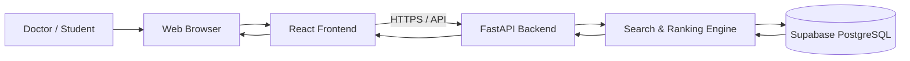
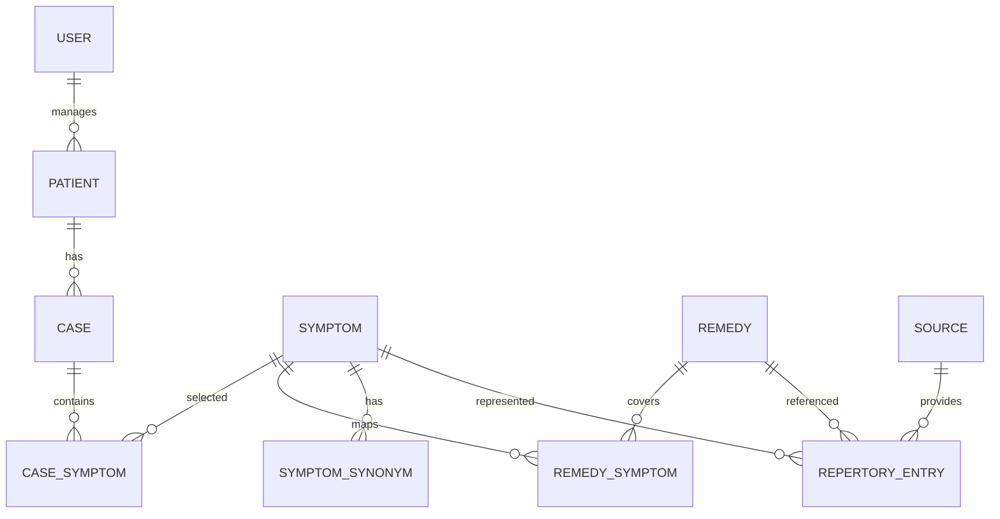
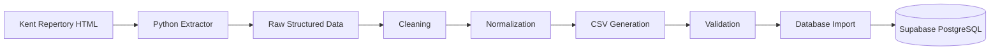
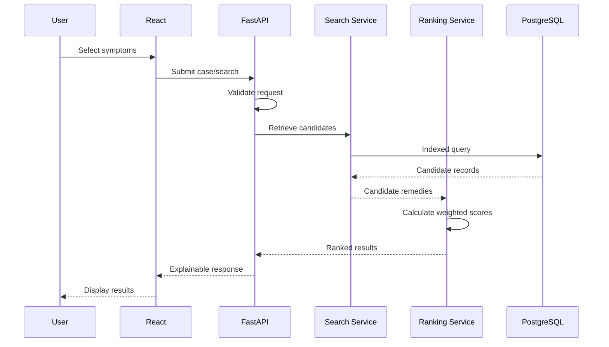

# Symptom2Cure
## Software Architecture Document

**Version:** 1.0  
**Status:** Draft — Architecture Baseline  
**Date:** August 2026  
**Project:** Symptom2Cure  
**Audience:** Development Team, AI Coding Agents, Faculty Advisors, Technical Reviewers

---

# 1. Architecture Overview

Symptom2Cure is a **browser-based web application** that provides structured symptom searching, repertory-based remedy retrieval, weighted remedy ranking, and explainable results.

The system consists of two major technical domains:

### Runtime Application

```text
Web Browser
    ↓
React Frontend
    ↓
FastAPI Backend
    ↓
Search / Ranking Services
    ↓
Supabase PostgreSQL
```

### Knowledge-Base Data Pipeline

```text
Kent Repertory HTML
        ↓
Python Extraction Scripts
        ↓
Data Cleaning
        ↓
Data Transformation
        ↓
CSV Dataset
        ↓
Validation
        ↓
Supabase PostgreSQL
```

The two domains are intentionally separated.

The Python extraction pipeline is responsible for **creating and updating the knowledge base**.

The web application is responsible for **using the knowledge base at runtime**.

---

# 2. Architecture Goals

The architecture shall prioritize:

1. Performance
2. Maintainability
3. Scalability
4. Data integrity
5. Explainability
6. Security
7. Clear separation of responsibilities
8. Ease of development
9. Future extensibility
10. Testability

The architecture should support the current academic project while avoiding unnecessary enterprise-level complexity.

---

# 3. Architecture Principles

## 3.1 Separation of Concerns

Each component should have one primary responsibility.

```text
Frontend
    → User interface

Backend API
    → Application/business logic

Search Service
    → Symptom/repertory retrieval

Ranking Service
    → Remedy scoring

Repository Layer
    → Database access

Database
    → Persistent data

Python ETL
    → Knowledge-base ingestion
```

A component must not take over responsibilities belonging to another layer.

---

# 4. System Context

The primary user interacts with Symptom2Cure through a standard web browser.



The user should never be required to understand the internal database or data-ingestion process.

---

# 5. High-Level Architecture

```text
┌───────────────────────────────────────────────────────────┐
│                       CLIENT LAYER                        │
│                                                           │
│                  React + Vite + TypeScript                │
│                                                           │
│  Dashboard | Patients | Cases | Symptoms | Remedies       │
│                                                           │
└───────────────────────────┬───────────────────────────────┘
                            │
                         HTTPS
                            │
                            ▼
┌───────────────────────────────────────────────────────────┐
│                     APPLICATION LAYER                     │
│                                                           │
│                      FastAPI Backend                      │
│                                                           │
│  API Routes                                               │
│       ↓                                                   │
│  Validation                                               │
│       ↓                                                   │
│  Services                                                 │
│       ↓                                                   │
│  Search / Ranking                                         │
│       ↓                                                   │
│  Repositories                                             │
│                                                           │
└───────────────────────────┬───────────────────────────────┘
                            │
                            ▼
┌───────────────────────────────────────────────────────────┐
│                        DATA LAYER                         │
│                                                           │
│                  Supabase PostgreSQL                      │
│                                                           │
│  Patients | Cases | Symptoms | Remedies                   │
│  Remedy-Symptom Relationships | Repertory | Sources       │
│                                                           │
└───────────────────────────────────────────────────────────┘
```

---

# 6. Technology Stack

## 6.1 Frontend

### React

Used for:

- Component-based UI
- State-driven interface
- Reusable clinical workflow components
- Dynamic search results
- Case builder
- Remedy ranking interface

### Vite

Used as the frontend build and development tool.

Reasons:

- Fast development server
- Efficient production builds
- Simple React integration
- Suitable for the project size
- Excellent TypeScript support

### TypeScript

TypeScript shall be used instead of plain JavaScript.

Reasons:

- Compile-time type safety
- Better API integration
- Easier refactoring
- Improved developer experience
- Reduced runtime errors

### Tailwind CSS

Used for the application's styling system.

The UI should use reusable design tokens and components rather than page-specific styling wherever practical.

---

# 7. Backend Technology

## 7.1 Python

Python is the primary backend and data-processing language.

It is used for:

- FastAPI backend
- Data extraction
- Data transformation
- Data validation
- Search/ranking logic
- Future data-science/AI functionality

Using one language across the backend and data-processing pipeline reduces unnecessary technology fragmentation.

---

# 8. FastAPI Backend

FastAPI is the application's backend framework.

The backend provides the controlled interface between the browser and the database.

```text
React
   ↓
HTTP Request
   ↓
FastAPI
   ↓
Validation
   ↓
Business Logic
   ↓
Database
```

The frontend should not contain core business logic that must be trusted.

---

# 9. Why Use a Backend Between React and Supabase?

The architecture intentionally uses:

```text
React
   ↓
FastAPI
   ↓
Supabase
```

instead of putting all application logic directly into the browser.

The backend provides:

- Centralized business rules
- Search logic
- Remedy ranking
- Input validation
- Controlled database access
- Consistent error handling
- Authorization boundaries
- Easier testing
- Future integration with other services

The frontend should primarily be responsible for presentation and user interaction.

---

# 10. Database

## 10.1 Database Technology

The runtime database is:

**PostgreSQL hosted through Supabase.**

Supabase provides the managed database and supporting platform capabilities.

The application should treat PostgreSQL as the source of truth for runtime application data and the structured repertory knowledge base.

---

# 11. Database Responsibilities

The database stores:

### User Data

- Users
- Roles
- Authentication-related information as applicable

### Patient Data

- Patients
- Demographic information
- Case history

### Case Data

- Cases
- Case symptoms
- Symptom importance
- Case metadata

### Knowledge Base

- Symptoms
- Symptom hierarchy
- Synonyms
- Remedies
- Remedy-symptom relationships
- Repertory entries
- Source references
- Materia Medica information where available

---

# 12. Conceptual Data Model

The initial conceptual model is:



This is a conceptual model.

The final physical schema must be based on the actual extracted Kent data and validated against the project's requirements.

---

# 13. Data Ingestion Architecture

The data ingestion pipeline is a major subsystem of Symptom2Cure.

## 13.1 Source

The primary source is Kent Repertory HTML.

```text
Kent Repertory HTML Pages
```

The source should not be directly queried by the runtime application.

Instead, data is processed before being loaded into the database.

---

# 14. ETL Pipeline

The pipeline follows:



---

# 15. Extraction Layer

Python extraction scripts shall:

- Read source HTML
- Identify relevant repertory structures
- Extract required fields
- Preserve source relationships
- Produce structured records

The extraction layer should not contain application-specific UI logic.

---

# 16. Transformation Layer

The transformation process should handle:

- Whitespace normalization
- HTML artifact removal
- Text normalization
- Field mapping
- Duplicate detection
- Canonical symptom preparation
- Grade normalization where applicable
- Relationship normalization

Transformation rules should be deterministic wherever possible.

---

# 17. CSV Layer

CSV acts as an intermediate data-exchange format.

Example conceptual structure:

```text
raw HTML
    ↓
Python processing
    ↓
CSV
    ↓
validation
    ↓
database import
```

CSV files should not become the application's runtime data source.

The web application should query PostgreSQL.

---

# 18. Data Validation

Before importing data into Supabase, the pipeline should validate:

### Structural Validation

- Required columns exist
- Expected data types are present
- No malformed records

### Content Validation

- Required values are not unexpectedly empty
- Grades contain valid values
- Remedy references are valid
- Symptom references are valid

### Relationship Validation

- Every remedy-symptom relationship references valid entities
- Duplicate mappings are identified
- Invalid foreign-key candidates are reported

### Quality Reports

The pipeline should generate a validation report containing:

- Total records
- Valid records
- Invalid records
- Duplicate records
- Missing values
- Warnings
- Import status

---

# 19. Database Import Strategy

The preferred conceptual workflow is:

```text
CSV
 ↓
Validation
 ↓
Staging / Import Preparation
 ↓
Database Import
 ↓
Constraint Validation
 ↓
Production Tables
```

Large datasets should not be inserted through one request per row.

Bulk import mechanisms should be used where practical.

The import process should be repeatable.

---

# 20. Data Versioning

Knowledge-base imports should have identifiable versions.

Conceptually:

```text
Dataset Version
      │
      ├── Source
      ├── Extraction Date
      ├── Transformation Version
      ├── Record Count
      └── Validation Status
```

This allows the team to identify which dataset version produced a particular database state.

---

# 21. Runtime Request Flow

The main runtime flow is:



---

# 22. Symptom Search Architecture

Symptom search is one of the most performance-sensitive components.

The system should avoid downloading or scanning the complete knowledge base in the browser.

## Search Flow

```text
User types
    ↓
React search component
    ↓
Debounced API request
    ↓
FastAPI validation
    ↓
Search service
    ↓
PostgreSQL indexed search
    ↓
Matching symptoms
    ↓
API response
    ↓
Autocomplete UI
```

The PRD specifies a debounce target of **≤ 200 ms**.

---

# 23. Search Strategy

The search system should support different retrieval strategies depending on the query.

### Exact Matching

Useful for:

- Canonical symptom
- Remedy name
- Known identifier

### Prefix / Autocomplete Matching

Useful for:

```text
head...
```

returning relevant symptom entries.

### Partial Matching

Useful for incomplete or partial terms.

### Synonym Matching

Multiple expressions should map to a canonical symptom where the knowledge base provides the relationship.

### Category Filtering

Search can be restricted by categories such as:

- Mental
- Physical
- General
- Modalities
- Sensations
- Locations
- Clinical

---

# 24. Database Search Optimization

The final indexing strategy must be benchmarked against the actual dataset.

Potential indexing approaches include:

- B-tree indexes for identifiers and equality filtering
- Composite indexes for frequently joined relationship tables
- PostgreSQL text-search mechanisms for textual retrieval
- Trigram-based indexing where appropriate for autocomplete/partial matching
- Full-text search where appropriate for longer textual content

The exact indexes must be selected based on actual query patterns and benchmark results.

Indexes should not be added indiscriminately because unnecessary indexes increase storage and write/update cost.

---

# 25. Remedy Candidate Retrieval

The ranking engine should not initially evaluate every remedy in the database for every case.

Instead:

```text
Selected Symptoms
      ↓
Indexed relationship lookup
      ↓
Candidate Remedy IDs
      ↓
Retrieve relevant mappings
      ↓
Ranking
```

This reduces unnecessary computation.

---

# 26. Remedy Ranking Architecture

The ranking engine is separated from database access.

```text
Case Symptoms
      ↓
Candidate Remedies
      ↓
Symptom Match Evaluation
      ↓
Grade Contribution
      ↓
Importance Weight
      ↓
Keynote / Peculiar Weight
      ↓
Coverage Calculation
      ↓
Final Score
      ↓
Ranking
```

The exact formula must be finalized through implementation and domain validation.

---

# 27. Explainability Architecture

The ranking engine should return not only a score but the components that produced that score.

Conceptual response:

```json
{
  "remedy": "Example Remedy",
  "score": 18,
  "coverage": 0.80,
  "matched_symptoms": [],
  "missing_symptoms": [],
  "grade_contributions": [],
  "references": []
}
```

The exact API schema will be defined separately.

The principle is:

> Every important recommendation must be explainable from the underlying data and scoring logic.

---

# 28. Frontend Architecture

The React application should use a feature-oriented structure.

```text
frontend/
│
├── src/
│   │
│   ├── app/
│   │
│   ├── components/
│   │
│   ├── features/
│   │   ├── auth/
│   │   ├── dashboard/
│   │   ├── patients/
│   │   ├── cases/
│   │   ├── symptoms/
│   │   ├── remedies/
│   │   └── search/
│   │
│   ├── pages/
│   │
│   ├── services/
│   │
│   ├── hooks/
│   │
│   ├── types/
│   │
│   ├── utils/
│   │
│   └── styles/
│
├── public/
│
└── package.json
```

Feature modules should contain feature-specific logic rather than placing everything in a global component directory.

---

# 29. Backend Architecture

The FastAPI backend should follow layered architecture.

```text
backend/
│
├── app/
│   │
│   ├── main.py
│   │
│   ├── api/
│   │   └── routes/
│   │
│   ├── core/
│   │   ├── config/
│   │   ├── security/
│   │   └── logging/
│   │
│   ├── schemas/
│   │
│   ├── services/
│   │
│   ├── search/
│   │
│   ├── ranking/
│   │
│   ├── repositories/
│   │
│   ├── models/
│   │
│   └── utils/
│
├── tests/
│
└── requirements.txt
```

---

# 30. Backend Layer Responsibilities

## API Layer

Responsible for:

- HTTP endpoints
- Request handling
- Authentication dependencies
- Response formatting

It should not contain complex ranking logic.

## Schema Layer

Responsible for:

- Request validation
- Response validation
- Type definitions

## Service Layer

Responsible for:

- Business workflows
- Case processing
- Search orchestration
- Remedy analysis

## Search Layer

Responsible for:

- Symptom retrieval
- Query construction
- Search optimization
- Candidate retrieval

## Ranking Layer

Responsible for:

- Remedy scoring
- Coverage calculation
- Ranking
- Explanation generation

## Repository Layer

Responsible for:

- Database queries
- Data persistence
- Database-specific access

The repository should not contain user-interface logic.

---

# 31. API Architecture

The backend should expose a versioned API.

Conceptually:

```text
/api/v1/
```

Potential resource groups:

```text
/auth
/patients
/cases
/symptoms
/remedies
/search
/repertory
/admin
```

The final endpoint list should be defined based on implemented requirements rather than creating unnecessary endpoints in advance.

---

# 32. API Request Flow

```text
HTTP Request
     ↓
Authentication
     ↓
Request Validation
     ↓
Service
     ↓
Repository / Search / Ranking
     ↓
Database
     ↓
Response Schema
     ↓
HTTP Response
```

---

# 33. API Error Handling

Errors should be standardized.

Conceptually:

```json
{
  "success": false,
  "error": {
    "code": "VALIDATION_ERROR",
    "message": "Invalid symptom selection.",
    "details": {}
  }
}
```

The API should avoid exposing:

- Database credentials
- Internal stack traces
- Sensitive implementation details
- SQL statements

Detailed errors should be logged server-side.

---

# 34. Authentication & Authorization

The application requires secure authentication.

Potential roles:

```text
Doctor / Practitioner
Administrator
```

The final authentication architecture must align with the selected Supabase authentication approach and project requirements.

Authorization should be enforced server-side for protected operations.

The frontend must never be treated as the security boundary.

---

# 35. Security Architecture

Security requirements include:

- HTTPS in deployed environments
- Secure authentication
- Server-side authorization
- Input validation
- Parameterized database operations
- Secure environment variables
- Restricted database credentials
- Protection of patient information
- Appropriate audit logging
- Safe error responses

Secrets must never be committed to Git.

---

# 36. Environment Configuration

Configuration must be environment-specific.

Example:

```text
.env
.env.example
```

Sensitive values include:

- Database connection information
- API secrets
- Authentication secrets
- External service credentials

`.env` files containing secrets must not be committed to source control.

---

# 37. Performance Architecture

Primary targets from the PRD:

```text
Symptom Search       < 500 ms target
Remedy Ranking       < 1 second target
Application Load     < 3 seconds target
Dataset              1M+ indexed records
```

These are targets and must be validated through actual benchmarking.

---

# 38. Performance Principles

## Avoid Full Dataset Transfer

The browser should never download the complete repertory database.

## Avoid Unnecessary Full Table Scans

Queries should use appropriate indexes.

## Retrieve Only Required Columns

Do not return large Materia Medica narratives when an autocomplete query only needs:

```text
id
name
category
```

## Pagination

Large result sets must be paginated or otherwise bounded.

## Candidate Reduction

Ranking should operate on a candidate set rather than blindly processing the complete database whenever possible.

---

# 39. Caching Strategy

Caching should be introduced only where measurement demonstrates a benefit.

Potential candidates:

- Frequently searched symptoms
- Static remedy metadata
- Repertory reference information
- Non-sensitive knowledge-base metadata

Patient-specific data should not be cached casually.

The initial implementation should prioritize correct database indexing and query optimization before introducing a complex caching layer.

---

# 40. Reliability

The system should handle:

- Database unavailable
- Invalid API requests
- Empty search results
- Malformed imported data
- Authentication failures
- Unexpected server errors
- Network interruptions

The UI should provide clear feedback rather than silently failing.

---

# 41. Observability

The backend should provide structured logging.

Useful metrics include:

- API response time
- Search latency
- Ranking latency
- Database query latency
- Error rate
- Request volume
- Import duration
- Import failures
- Number of imported records
- Validation failures

Performance bottlenecks should be identified using measurements rather than assumptions.

---

# 42. Data Pipeline Observability

Each ingestion run should ideally record:

```text
Dataset version
Source
Extraction timestamp
Input record count
Valid record count
Invalid record count
Duplicate count
Imported record count
Failed record count
Processing duration
```

This makes the data pipeline auditable and easier to debug.

---

# 43. Testing Architecture

Testing should occur at multiple levels.

## Unit Tests

Test:

- Symptom normalization
- Search utilities
- Ranking calculations
- Coverage calculation
- Data transformations

## Integration Tests

Test:

- API + database
- Search + database
- Ranking + candidate retrieval
- Data import + database

## Frontend Tests

Test:

- Search interaction
- Case builder
- Result rendering
- Form validation

## End-to-End Tests

Test complete workflows:

```text
Login
 ↓
Create patient
 ↓
Create case
 ↓
Select symptoms
 ↓
Analyze
 ↓
View ranked remedies
```

---

# 44. Data Pipeline Testing

The ingestion pipeline must be tested separately.

Example:

```text
HTML Fixture
    ↓
Extractor Test
    ↓
Transformer Test
    ↓
CSV Validation
    ↓
Database Import Test
```

This is important because a bug in extraction can corrupt the knowledge base even if the web application itself is functioning correctly.

---

# 45. Deployment Architecture

The application is browser-based.

Conceptually:

```text
User Browser
      │
      ▼
Frontend Hosting
      │
      ▼
FastAPI Backend
      │
      ▼
Supabase PostgreSQL
```

The Python ingestion pipeline is run separately from normal user requests.

```text
Developer / Data Pipeline
        ↓
Python ETL
        ↓
Validated Dataset
        ↓
Supabase
```

The ingestion scripts should not execute as part of every user search.

---

# 46. Source Control

Git should be used for source control.

Recommended repository structure:

```text
symptom2cure/
│
├── frontend/
├── backend/
├── data-pipeline/
├── docs/
├── scripts/
├── tests/
└── README.md
```

Large generated datasets should not automatically be committed to Git.

Source extraction scripts and dataset-generation configuration should be version controlled.

---

# 47. Recommended Complete Repository Structure

```text
symptom2cure/
│
├── frontend/
│   ├── src/
│   ├── public/
│   ├── tests/
│   └── package.json
│
├── backend/
│   ├── app/
│   │   ├── api/
│   │   ├── core/
│   │   ├── models/
│   │   ├── schemas/
│   │   ├── repositories/
│   │   ├── services/
│   │   ├── search/
│   │   ├── ranking/
│   │   └── utils/
│   │
│   ├── tests/
│   └── requirements.txt
│
├── data-pipeline/
│   ├── extractors/
│   ├── transformers/
│   ├── validators/
│   ├── loaders/
│   ├── schemas/
│   ├── tests/
│   └── README.md
│
├── data/
│   ├── raw/
│   ├── processed/
│   └── validation/
│
├── scripts/
│
├── docs/
│   ├── PRD.md
│   ├── Architecture.md
│   ├── Rules.md
│   ├── Phases.md
│   ├── Design.md
│   └── Memory.md
│
├── .env.example
├── .gitignore
├── README.md
└── LICENSE
```

---

# 48. Dependency Direction

Dependencies should flow inward toward business logic.

Preferred:

```text
API
 ↓
Services
 ↓
Domain Logic
 ↓
Repositories
 ↓
Database
```

The following should be avoided:

```text
Database
 ↓
Frontend
```

or:

```text
React Component
 ↓
Raw SQL
```

or:

```text
API Route
 ↓
1000 lines of ranking logic
```

Business logic should remain independently testable.

---

# 49. Search and Ranking Separation

Search and ranking are separate responsibilities.

### Search

Answers:

> "Which remedies could potentially match these symptoms?"

### Ranking

Answers:

> "Among those candidates, which remedies score highest according to our defined rules?"

Therefore:

```text
Search
   ↓
Candidate Set
   ↓
Ranking
   ↓
Ordered Results
```

This separation allows the search implementation to evolve independently from the scoring methodology.

---

# 50. Knowledge Base and Application Data Separation

The system contains two conceptual classes of data.

## Knowledge Data

Relatively stable:

- Symptoms
- Remedies
- Repertory mappings
- Materia Medica
- Sources

## Application Data

User-generated:

- Users
- Patients
- Cases
- Selected symptoms
- Notes
- Case history

The architecture should keep these concepts logically separated.

---

# 51. Medical Disclaimer

The frontend shall display a persistent medical disclaimer.

The system must communicate that:

- Results are decision-support information
- The application does not diagnose disease
- The application does not prescribe treatment
- The practitioner remains responsible for clinical decisions

The disclaimer must not be hidden behind a complex navigation path.

---

# 52. Data Privacy

Patient information should be treated as sensitive application data.

The application should:

- Minimize unnecessary data collection
- Restrict access to authorized users
- Avoid exposing patient information in logs
- Avoid returning unnecessary patient fields through APIs
- Use secure transport
- Apply appropriate database access controls

The exact legal/privacy requirements must be reviewed according to the deployment context.

---

# 53. Future AI Integration

AI is intentionally separated from the core Version 1 architecture.

Potential future architecture:

```text
                    ┌───────────────────┐
                    │   React Frontend  │
                    └─────────┬─────────┘
                              │
                              ▼
                    ┌───────────────────┐
                    │   FastAPI API     │
                    └─────────┬─────────┘
                              │
                 ┌────────────┴────────────┐
                 │                         │
                 ▼                         ▼
          Search/Ranking             Future AI Service
                 │                         │
                 └────────────┬────────────┘
                              ▼
                    Supabase PostgreSQL
```

The Version 1 system must remain functional without requiring an AI model.

Future AI functionality must not silently replace deterministic ranking logic.

---

# 54. Architecture Decision Summary

| Decision | Choice | Reason |
|---|---|---|
| Application type | Browser-based web app | Primary project requirement |
| Frontend | React + Vite + TypeScript | Component-based, maintainable UI |
| Styling | Tailwind CSS | Consistent design system |
| Backend | Python + FastAPI | Python ecosystem and project requirements |
| Runtime database | Supabase PostgreSQL | Relational, indexed, scalable |
| Data extraction | Python | Same ecosystem as backend |
| Intermediate format | CSV | Simple structured exchange format |
| Primary source | Kent Repertory HTML | Initial knowledge source |
| API | Backend-mediated | Business logic and security boundary |
| Search | PostgreSQL indexed retrieval | Avoid unnecessary full scans |
| Ranking | Dedicated ranking service | Separation from retrieval |
| Authentication | Secure application authentication | Protected user functionality |
| AI | Future extension | Not required for core v1 |

---

# 55. Architecture Constraints

The project has the following constraints:

- Academic project timeline
- Limited development team
- Limited hardware/resources
- Large knowledge-base dataset
- Need for explainable results
- Need for reproducible data ingestion
- Need for maintainable code
- Need to avoid unnecessary infrastructure complexity

The architecture should therefore favor **simple, measurable, modular solutions** over premature enterprise complexity.

---

# 56. What Must Not Be Done

The implementation should avoid:

### 1. Browser-Side Full Dataset Search

Do not download the complete knowledge base to the browser.

### 2. CSV as Runtime Database

CSV is an ingestion/interchange format, not the production query layer.

### 3. Raw SQL Inside React

Database operations must go through the backend architecture.

### 4. Ranking Inside UI Components

Ranking belongs to the backend/service layer.

### 5. Full Table Scan by Default

Search queries should use appropriate indexing.

### 6. Unvalidated Dataset Import

Data should pass validation before becoming part of the primary knowledge base.

### 7. Hardcoded Knowledge Base

Knowledge data must remain separate from application source code.

### 8. AI Before Core Search Works

The deterministic search and ranking foundation must work before adding AI functionality.

---

# 57. Architecture Development Strategy

Implementation should proceed in this order:

```text
Requirements
     ↓
Database Schema
     ↓
Data Extraction
     ↓
Data Validation
     ↓
Supabase Import
     ↓
Search Queries
     ↓
Backend API
     ↓
Ranking Engine
     ↓
Frontend
     ↓
Integration
     ↓
Testing
     ↓
Performance Optimization
     ↓
Deployment
```

This order may be adjusted based on actual development discoveries, but the team should avoid building the UI independently of the underlying data/search model for too long.

---

# 58. Architecture Validation

Before declaring the architecture stable, the team should validate:

### Data

- Can Kent HTML be reliably transformed into structured records?
- Are relationships preserved?
- Are duplicate records handled?
- Are grades represented consistently?

### Database

- Can the expected dataset be imported?
- Are indexes effective?
- Are relationships correct?
- Are queries performant?

### Search

- Can autocomplete meet the target?
- Can multiple symptoms be retrieved efficiently?
- Can candidate remedies be generated without scanning the entire dataset?

### Ranking

- Are scores deterministic?
- Are explanations reproducible?
- Can domain experts understand the scoring?

### Application

- Can the browser communicate reliably with the backend?
- Are errors handled correctly?
- Is authentication secure?

---

# 59. Definition of an Architecture-Complete MVP Foundation

The architecture foundation will be considered implemented when:

- React application is connected to the backend
- FastAPI backend is running
- Supabase PostgreSQL is connected
- Core schema is implemented
- Kent data has passed through the Python ingestion pipeline
- Validated data is imported
- Symptom search works through indexed database queries
- Candidate remedies can be retrieved
- Ranking logic is implemented separately
- Frontend can display explainable results
- Core workflow is covered by automated tests
- Performance has been benchmarked

---

# 60. Final Architecture

The final Version 1 architecture can be summarized as:

```text
                         SYMPTOM2CURE
                              │
             ┌────────────────┴────────────────┐
             │                                 │
             ▼                                 ▼
      DATA PIPELINE                     WEB APPLICATION
             │                                 │
             │                                 │
 Kent Repertory HTML                     Web Browser
             │                                 │
             ▼                                 ▼
      Python Extractor                    React + Vite
             │                                 │
             ▼                                 ▼
       Transformation                     HTTPS / API
             │                                 │
             ▼                                 ▼
        CSV Dataset                      FastAPI Backend
             │                                 │
             ▼                         ┌───────┴────────┐
        Validation                      │                │
             │                          ▼                ▼
             ▼                       Search          Ranking
      Supabase Import                  │                │
             │                          └───────┬────────┘
             │                                  │
             └──────────────┐                   │
                            ▼                   ▼
                     ┌─────────────────────────────┐
                     │     Supabase PostgreSQL     │
                     │                             │
                     │ Symptoms                    │
                     │ Remedies                    │
                     │ Remedy-Symptom Mappings     │
                     │ Repertory Entries           │
                     │ Sources                     │
                     │ Patients                    │
                     │ Cases                       │
                     └─────────────────────────────┘
```

The core architectural principle is:

> **Separate knowledge-base construction from application runtime, separate retrieval from ranking, and separate business logic from presentation.**

This gives Symptom2Cure a practical architecture for the current academic project while preserving a clear path toward larger datasets, additional repertories, advanced search, and future AI-assisted functionality.

---

**Symptom2Cure Architecture Document v1.0**  
**Draft — August 2026**  
**Subject to revision following database implementation, performance benchmarking, and development findings.**